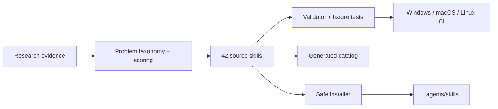

# Vibe Coding Skills

**42 evidence-backed Agent Skills for making AI-assisted software development easier to verify, debug, secure, review, and ship.**

Vibe Coding Skills turns recurring failures in AI-generated software into repeatable workflows with explicit triggers, ordered procedures, safety boundaries, validation, failure handling, and completion criteria. The repository also provides a dependency-free Python CLI for discovery and safe installation.

## Why this exists

Current evidence shows that AI coding failures are often plausible enough to survive casual review. The research corpus here contains **117 traceable evidence rows**, **55 candidate problem patterns**, and **20 problem patterns supported by at least two distinct source titles**. High-priority patterns include plausible-but-wrong code, missing context, hallucinated dependencies, weak verification, security defects, regressions, agent loops, fake completeness, scope drift, and deployment mismatch.

See [research methodology](research/research-methodology.md), [problem inventory](research/vibe-coding-problems.md), [evidence CSV](research/problem-evidence.csv), and [research limitations](research/research-limitations.md).

## What is actually validated

| Status | Current evidence |
|---|---:|
| Original skills implemented | **42** |
| Structurally validated | **42** |
| Skills with fixture-tested deterministic helpers | **5** |
| Local unit/fixture tests | **22** before the current CI push |
| Agent-level behavioral runs | **0** in the current build environment |
| Documented skill-compatible ecosystems | OpenAI Agent Skills, Claude Code, Cursor, GitHub Copilot |

Structural validation is intentionally separate from agent-level effectiveness. The active Windows environment did not expose Codex CLI, so this release does **not** claim measured baseline-vs-skill agent improvements. See [validation report](docs/validation-report.md) and [benchmark results](docs/benchmark-results.md).

## Quick start

Clone the repository and use the source tree directly without installing dependencies:

### PowerShell

    git clone https://github.com/aradmanamnaoon/vibe-coding-skills.git
    cd vibe-coding-skills
    $env:PYTHONPATH = "src"
    py -m vibe_skills list
    py -m vibe_skills search debugging
    py -m vibe_skills doctor

### macOS / Linux

    git clone https://github.com/aradmanamnaoon/vibe-coding-skills.git
    cd vibe-coding-skills
    PYTHONPATH=src python -m vibe_skills list
    PYTHONPATH=src python -m vibe_skills search security
    PYTHONPATH=src python -m vibe_skills doctor

A normal Python package installation is also supported where build dependencies can be resolved:

    python -m pip install -e .
    vibe-skills doctor

## Install skills

The committed `skills/` tree is the source of truth. Installation copies selected bundles into an agent-visible destination such as `.agents/skills/`.

    py -m vibe_skills install root-cause-debugger
    py -m vibe_skills install --category security
    py -m vibe_skills install --dry-run completion-claims-auditor
    py -m vibe_skills install
    py -m vibe_skills update root-cause-debugger
    py -m vibe_skills remove root-cause-debugger

The installer refuses destructive overwrites, rejects traversal outside the destination, removes only installer-managed skills, and refuses to update an installed skill that has been modified locally.

## Skill categories

| Category | Examples |
|---|---|
| Agent reliability | completion claims, requirement traceability, scope drift, context recovery, multi-agent integration, MCP reliability |
| Security | secrets, authentication, authorization, injection, input validation, dependency risk, configuration, tool trust |
| Testing | regression detection, missing/weak tests, realistic integrations, API contracts, browser flows |
| Debugging | root-cause diagnosis, reproduction building, progress-aware loop breaking |
| Deployment & release | CI failures, environment parity/configuration, production readiness, cross-platform checks, release verification |
| Frontend | dead features, accessibility, responsive behavior, async UX states |
| Backend & architecture | schema/migration safety, consistency, dependency cycles, architecture complexity |
| Documentation & efficiency | documentation accuracy and token/tool-call discipline |

Browse the complete generated [skill catalog](catalog/SKILLS.md) or search with the CLI.

## Five deterministic helpers

Some tasks benefit from deterministic code rather than model judgment. Five skills currently bundle standard-library helpers with fixture tests:

- `secret-leakage-detector` — redacted credential-pattern signals;
- `test-quality-auditor` — skipped/disabled-test discovery;
- `dead-feature-detector` — placeholder/no-op UI signals;
- `environment-config-auditor` — Python/JavaScript environment-key discovery;
- `dependency-cycle-auditor` — static Python import-cycle detection.

These helpers emit reviewable signals. They do not silently rewrite source code.

## How the repository fits together

The design and threat model are documented in [architecture](docs/architecture.md), [testing strategy](docs/testing-strategy.md), and [security model](docs/security-model.md).

## Compatibility

The portable core uses `SKILL.md` with `name` and `description` front matter plus optional local resources. Current vendor documentation supports Agent Skills in OpenAI's ecosystem, Claude Code, Cursor, and GitHub Copilot. This repository has validated its **structure** against that shared model; runtime behavior on those products is recorded separately and is not claimed where it was not executed.

See [compatibility matrix](docs/compatibility-matrix.md) and [compatibility research](docs/compatibility-research.md).

## MCP philosophy

MCP is useful when a workflow needs live external state, persistent browser sessions, or controlled external actions. It is not installed as a hidden side effect of a skill. The repository evaluated filesystem, browser, GitHub, registry, and documentation integrations and documents a small optional profile in [MCP evaluation](research/mcp-evaluation.md) and [`config/mcp.example.json`](config/mcp.example.json).

## Research and benchmark honesty

Research targets are not quota-filling exercises. Public issue reports demonstrate concrete failure modes but do not establish prevalence. Survey percentages are kept as reported and are not converted into defect rates. The current benchmark report explicitly records that no controlled agent-with-skill versus agent-without-skill experiment was executed in this environment.

See [benchmark methodology](docs/benchmark-methodology.md), [benchmark results](docs/benchmark-results.md), and [known limitations](docs/known-limitations.md).

## Contributing

Read [CONTRIBUTING.md](CONTRIBUTING.md). New skills should solve a distinct recurring problem, cite traceable evidence, define a bounded workflow, and provide a credible validation path. Generic advice or count-inflating splits are not enough.

Security issues should follow [SECURITY.md](SECURITY.md). Community behavior is covered by [CODE_OF_CONDUCT.md](CODE_OF_CONDUCT.md).

## Roadmap and license

See [ROADMAP.md](ROADMAP.md) for behavioral-harness and ecosystem-adapter work. Original repository content is available under the [MIT License](LICENSE).

