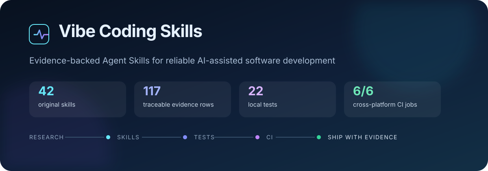
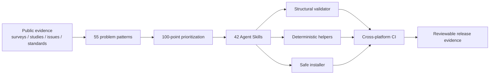
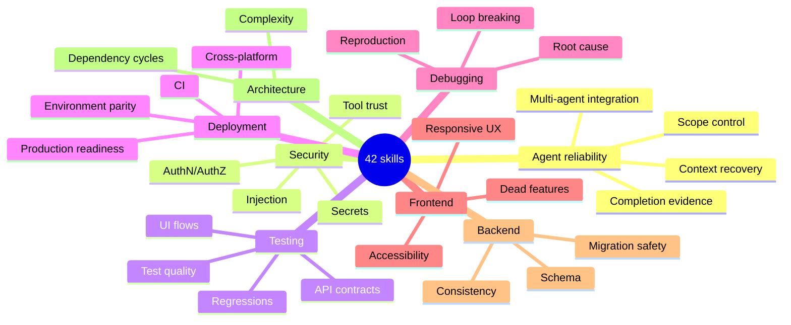

<div align="center">

# Vibe Coding Skills

### Evidence-backed Agent Skills for software you can actually verify



**42 portable workflows for debugging, testing, security, deployment, architecture, review, and agent reliability.**

[](https://github.com/aradmanamnaoon/vibe-coding-skills/actions/workflows/validate.yml)


**Windows | macOS | Linux**

**OpenAI Agent Skills | Claude Code | Cursor | GitHub Copilot**

[Browse skills](catalog/SKILLS.md) | [Research](research/README.md) | [Validation](docs/validation-report.md) | [Docs](docs/README.md) | [Roadmap](ROADMAP.md)

</div>

---

## Why this repository exists

AI-generated code often looks finished before it is finished. This project converts recurring AI-assisted development failures into bounded, reusable workflows with explicit activation triggers, ordered checks, safety restrictions, observable evidence, failure handling, and completion criteria.

The research corpus contains **117 traceable evidence rows**, **55 candidate problem patterns**, and **20 problem patterns supported by at least two distinct source titles**. Those findings are scored before a skill is added; the library is not padded to reach a target count.

| Research | Library | Validation |
|---|---|---|
| 117 evidence rows | 42 original skills | 42/42 structurally valid |
| 55 candidate problems | 12 categories | 5/5 helper benchmarks pass |
| 20 independently corroborated patterns | 5 deterministic helpers | 22/22 local tests pass |

> **Design rule:** a skill is useful only if it changes what the agent does and produces evidence a reviewer can inspect.

## Explore

| | Area | Start here |
|---|---|---|
| 01 | **Skill library** | [`skills/README.md`](skills/README.md) for categories, recommended starting skills, structure, and installation |
| 02 | **Research** | [`research/README.md`](research/README.md) for methodology, evidence strength, taxonomy, scoring, and limitations |
| 03 | **Validation** | [`docs/validation-report.md`](docs/validation-report.md) and [`docs/benchmark-results.md`](docs/benchmark-results.md) for observed results |
| 04 | **Documentation** | [`docs/README.md`](docs/README.md) for architecture, compatibility, security, testing, environment, and release evidence |

## Pick a high-value skill

| Skill | Use it when... | Install |
|---|---|---|
| [`completion-claims-auditor`](skills/agent-reliability/completion-claims-auditor/SKILL.md) | an agent claims done, fixed, shipped, or pushed | `python -m vibe_skills install completion-claims-auditor` |
| [`root-cause-debugger`](skills/debugging/root-cause-debugger/SKILL.md) | fixes keep treating symptoms instead of the cause | `python -m vibe_skills install root-cause-debugger` |
| [`existing-work-preservation`](skills/agent-reliability/existing-work-preservation/SKILL.md) | an established project must not regress during AI edits | `python -m vibe_skills install existing-work-preservation` |
| [`secret-leakage-detector`](skills/security/secret-leakage-detector/SKILL.md) | code/configuration may contain credentials or private keys | `python -m vibe_skills install secret-leakage-detector` |
| [`test-quality-auditor`](skills/testing/test-quality-auditor/SKILL.md) | the suite is green but confidence is low | `python -m vibe_skills install test-quality-auditor` |
| [`release-verification-agent`](skills/release/release-verification-agent/SKILL.md) | version metadata, artifacts, tags, and publication need cross-checking | `python -m vibe_skills install release-verification-agent` |

Browse all **42 skills** in the generated [catalog](catalog/SKILLS.md).

## How the system works



The source of truth is `skills/`. Generated catalog entries, validation reports, benchmarks, examples, and installation copies are downstream artifacts.

## Quick start

No runtime dependency is required beyond Python 3.10+.

<details>
<summary><strong>PowerShell</strong></summary>

```powershell
git clone https://github.com/aradmanamnaoon/vibe-coding-skills.git
cd vibe-coding-skills
$env:PYTHONPATH = "src"

py -m vibe_skills list
py -m vibe_skills search debugging
py -m vibe_skills doctor
```

</details>

<details>
<summary><strong>macOS / Linux</strong></summary>

```bash
git clone https://github.com/aradmanamnaoon/vibe-coding-skills.git
cd vibe-coding-skills
export PYTHONPATH=src

python -m vibe_skills list
python -m vibe_skills search security
python -m vibe_skills doctor
```

</details>

Optional editable installation:

```bash
python -m pip install -e .
vibe-skills doctor
```

## Install safely

The installer copies selected bundles into an agent-visible destination such as `.agents/skills/`.

```bash
python -m vibe_skills install root-cause-debugger
python -m vibe_skills install --category security
python -m vibe_skills install --dry-run completion-claims-auditor
python -m vibe_skills update root-cause-debugger
python -m vibe_skills remove root-cause-debugger
```

Safety behavior is intentional:

- refuses destructive overwrites;
- rejects path traversal outside the destination;
- removes only installer-managed skills;
- refuses to update locally modified installed copies;
- supports dry-run previews before mutation.

The complete 42-skill library has also been smoke-installed into a disposable directory and validated as a set.

## Skill map

<p align="center">
  
</p>



For exact category counts and every skill, see [`skills/README.md`](skills/README.md).

## Deterministic helpers

Five skills include standard-library helper scripts for tasks where deterministic evidence is stronger than model judgment:

| Helper-backed skill | Signal |
|---|---|
| `secret-leakage-detector` | credential/private-key patterns with redacted output |
| `test-quality-auditor` | skipped/disabled test signals |
| `dead-feature-detector` | placeholder and no-op UI signals |
| `environment-config-auditor` | Python/JavaScript environment-key discovery |
| `dependency-cycle-auditor` | static Python import cycles |

Observed fixed-fixture result: **5/5 passed**. See [benchmark results](docs/benchmark-results.md).

## What is actually verified

| Status | Evidence |
|---|---:|
| Original skills implemented | **42** |
| Structurally validated | **42/42** |
| Deterministic helper benchmarks | **5/5 passed** |
| Local unit/fixture tests | **22/22 passed** |
| Hosted CI | **Windows + macOS + Linux**, Python 3.10 and 3.13 |
| Repository secret scan | **clean at release audit** |
| Full-library install smoke test | **42/42 installed and validated** |
| Agent-with-skill vs control benchmark | **not executed** |

Codex CLI `0.164.0` is installed and its runtime/configuration was inspected, but it is **not authenticated** on this host. Therefore this release does **not** claim controlled agent-level improvement measurements. That boundary is intentional; see [known limitations](docs/known-limitations.md).

## Compatibility

The portable core is a `SKILL.md` directory with `name` and `description` front matter plus optional local resources.

| Ecosystem | Documented skill support | Runtime behavior tested here |
|---|:---:|:---:|
| OpenAI Agent Skills / Codex | yes | structural only; Codex CLI unauthenticated |
| Claude Code | yes | no |
| Cursor | yes | no |
| GitHub Copilot | yes | no |

See the dated [compatibility matrix](docs/compatibility-matrix.md) and [compatibility research](docs/compatibility-research.md).

## MCP and plugin philosophy

This project does not install a large MCP/plugin bundle just because integrations exist. MCP is reserved for workflows needing live external state, persistent browser sessions, or controlled external actions.

The build environment verified GitHub access, Playwright MCP package availability, the official MCP filesystem package, and Codex plugin/MCP inventory. Additional credential-heavy or overlapping plugins remain optional rather than silently widening permissions.

See [MCP evaluation](research/mcp-evaluation.md) and [`config/mcp.example.json`](config/mcp.example.json).

## Repository map

```text
.
|-- skills/                 # 42 source-of-truth Agent Skills
|-- catalog/                # generated Markdown + JSON catalog
|-- research/               # evidence, taxonomy, prioritization, MCP/skill review
|-- src/vibe_skills/        # dependency-free CLI, catalog, installer, validation
|-- scripts/                # research, reporting, benchmark, lint, docs tooling
|-- tests/                  # unit and fixed-fixture tests
|-- docs/                   # architecture, security, compatibility, validation
|-- examples/               # concrete usage examples
\-- .github/                # CI and contribution templates
```

## Evidence over hype

This repository distinguishes:

- **implemented** from **behaviorally proven**;
- vendor-documented compatibility from runtime testing;
- public issue examples from prevalence evidence;
- deterministic helper success from full agent-workflow effectiveness;
- a local commit from a verified remote push;
- a green component test from a real integration or UI flow.

Research limitations are explicit in [`research/research-limitations.md`](research/research-limitations.md), and release limitations are explicit in [`docs/known-limitations.md`](docs/known-limitations.md).

## Contributing

New skills should solve a distinct recurring problem, cite traceable evidence, define a bounded workflow, and provide a credible validation path. Generic advice or count-inflating splits are not enough.

Read [CONTRIBUTING.md](CONTRIBUTING.md), report security issues through [SECURITY.md](SECURITY.md), and see [CODE_OF_CONDUCT.md](CODE_OF_CONDUCT.md) for community expectations.

## Roadmap and license

Next work focuses on controlled agent behavioral benchmarks, ecosystem-specific installation adapters, and stronger real-application fixtures. See [ROADMAP.md](ROADMAP.md).

Original repository content is available under the [MIT License](LICENSE).
