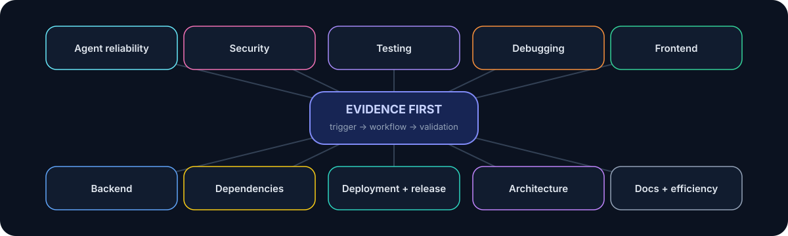

# Skill library

### 42 evidence-backed workflows · 12 categories · 5 deterministic helpers

[Full catalog](../catalog/SKILLS.md) · [Research](../research/README.md) · [Validation](../docs/validation-report.md) · [Root README](../README.md)

  

## Choose by problem

| Category | Skills | Typical use |
|---|---:|---|
| Security | **8** | secrets, authentication, authorization, injection, dependency risk, configuration, tool trust |
| Agent reliability | **7** | completion claims, context recovery, requirement traceability, scope drift, multi-agent/MCP reliability |
| Testing | **6** | missing tests, weak tests, regressions, realistic integrations, API contracts, UI flows |
| Deployment | **5** | CI failures, config, environment parity, production readiness, cross-platform behavior |
| Frontend | **4** | dead features, accessibility, responsive behavior, async/error/empty states |
| Backend | **3** | schema review, migration safety, data consistency |
| Debugging | **3** | reproducible failures, root cause, loop breaking |
| Architecture | **2** | unnecessary complexity, dependency cycles |
| Dependencies | **1** | hallucinated or ungrounded packages/APIs |
| Documentation | **1** | docs that drift from executable behavior |
| Efficiency | **1** | token/tool-call discipline without skipping validation |
| Release | **1** | version/artifact/tag/publication verification |

The generated [catalog](../catalog/SKILLS.md) is the authoritative browseable list.

## Recommended starter set

For a new AI-assisted project, start with a small complementary set rather than installing everything blindly:

| Skill | Why start here |
|---|---|
| [existing-work-preservation](agent-reliability/existing-work-preservation/SKILL.md) | prevents destructive rewrites and lost context |
| [completion-claims-auditor](agent-reliability/completion-claims-auditor/SKILL.md) | turns “done” into evidence-backed completion |
| [root-cause-debugger](debugging/root-cause-debugger/SKILL.md) | discourages repeated symptom patches |
| [test-quality-auditor](testing/test-quality-auditor/SKILL.md) | checks whether green tests actually establish confidence |
| [secret-leakage-detector](security/secret-leakage-detector/SKILL.md) | adds deterministic credential-pattern checks |
| [release-verification-agent](release/release-verification-agent/SKILL.md) | verifies the final repository/release state |

Install one safely:

~~~bash
python -m vibe_skills install root-cause-debugger
~~~

Preview first:

~~~bash
python -m vibe_skills install --dry-run root-cause-debugger
~~~

## Anatomy of every skill

~~~text
SKILL.md
├── Purpose
├── When to activate
├── When not to activate
├── Preconditions
├── Required inputs
├── Workflow
├── Relevant tools
├── Safety restrictions
├── Validation
├── Expected output
├── Failure handling
└── Completion criteria
~~~

This contract is intentionally stricter than generic prompt advice. A skill must define what activates it, what work it performs, what evidence it produces, and how a reviewer knows it is complete.

## Deterministic helpers

Five bundles add standard-library scripts where static evidence is stronger than model judgment:

| Skill | Helper | Fixed-fixture status |
|---|---|:---:|
| secret-leakage-detector | credential/private-key pattern scan with redacted output | pass |
| test-quality-auditor | skipped/disabled test discovery | pass |
| dead-feature-detector | placeholder/no-op UI signal scan | pass |
| environment-config-auditor | Python/JavaScript environment-key discovery | pass |
| dependency-cycle-auditor | static Python import-cycle detection | pass |

Observed aggregate helper benchmark: **5/5 passed**. This is helper validation, not proof of full LLM workflow effectiveness.

## From source to agent

~~~mermaid
flowchart LR
    A[skills/category/name] --> B[Structural validator]
    B --> C[Safe installer]
    C --> D[Agent-visible destination]
    A --> E[Optional deterministic helper]
    E --> F[Fixture benchmark]
    B --> G[Cross-platform CI]
    F --> G
~~~

The <code>skills/</code> tree is the distributable source of truth. The repository deliberately does not commit duplicate copies under agent discovery roots.

## Validation boundary

All **42/42** skills currently pass structural validation. **5** helper-backed skills have deterministic fixture coverage. Controlled agent-with-skill versus agent-without-skill experiments have **not** been executed, because the installed Codex CLI is unauthenticated and no alternate controlled harness was available.

See [validation report](../docs/validation-report.md), [benchmark methodology](../docs/benchmark-methodology.md), and [known limitations](../docs/known-limitations.md).
